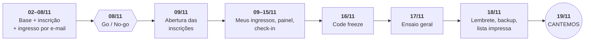
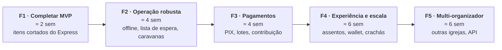

# 03 · Roadmap

Roadmap em fases incrementais. Cada fase termina com algo **em produção e utilizável** — nada fica "pronto só no fim".

Os códigos (AUTH-01, CHK-09…) estão definidos no [escopo](02-escopo.md).

> **CANTEMOS 2026 — quinta-feira, 19/11/2026 · gratuito · 120 lugares.**
> Com 17 dias entre o início do projeto (02/11) e o evento, as Fases 0 e 1 foram comprimidas no **Plano Express** abaixo. As fases seguintes (F1 completa → F5) passam a valer para depois do evento, já mirando o CANTEMOS 2027.

---

## Plano Express — CANTEMOS 2026 (02/11 → 19/11)

### Cronograma

| Data | Entrega | Itens do escopo |
|---|---|---|
| **Seg 02 – Ter 03/11** | Scaffolding front + back, banco, CI, login do organizador ✅ · configurações do evento no painel (horário, lotação, margem, limite por inscrição, prioridade, cotas reservadas) ✅ · envio de e-mail pelo Gmail ✅ · deploy gratuito ([guia](06-hospedagem-gratuita.md)) ⏳ | F0 enxuta, AUTH-01, AUTH-04 |
| **Qua 04 – Sex 06/11** | ✅ *Adiantado para 03/11:* página pública do CANTEMOS, inscrição familiar com controle de lotação (testado com 150 inscrições simultâneas), e-mail com QR Code, aceite LGPD, “meus ingressos”, cancelamento e reenvio | EVT-04, TKT-01–06, PART-01–03, COM-01, ADM-01, ADM-05 |
| **Sáb 07/11** | Teste interno com a equipe (inscrições reais pelo celular, e-mails chegando, lotação travando em 120) | — |
| **Dom 08/11** | **Go / No-go** para abrir as inscrições | — |
| **Seg 09/11** | **Abertura das inscrições** — divulgação nos cultos e grupos | — |
| **Seg 09 – Qua 11/11** | ✅ *Adiantado para 03/11:* lista de espera automática (vaga guardada por 24 h para o próximo da fila), lembretes por e-mail com botão no painel, números para a coordenação | TKT-09, COM-02, RPT-01, RPT-03, RPT-04 |
| **Qui 12 – Sáb 14/11** | ✅ *Adiantado para 03/11:* tela de check-in (câmera + busca por nome + prioridade + contador), vários operadores sem entrada duplicada, desfazer, acesso de voluntários por código | CHK-01–08, AUTH-06 |
| **Dom 15/11** | ✅ *Adiantado para 03/11:* exportação CSV e lista de presença para imprimir. Pendente: lista de espera e painel de números ao vivo para a coordenação | RPT-01, RPT-02, CHK-11, ADM-02 |
| **Seg 16/11** | **Code freeze** — a partir daqui só correção de bug crítico. E-mail "não poderá ir? cancele e libere sua vaga" | — |
| ~~Ter 17/11~~ | ~~Ensaio geral~~ — **dispensado pela coordenação** (03/11). Recomendado: cada voluntário abrir a recepção no próprio celular antes do evento e permitir a câmera | — |
| **Seg 16/11** e **Qua 18/11** | Coordenação aperta os botões dos lembretes no painel (*Números e lembretes*). Em 18/11: exportar a planilha (backup), imprimir a **lista de presença** (plano B), cancelar inscrições de teste | COM-02 |
| **Qui 19/11** | **CANTEMOS** — equipe técnica de plantão na portaria | — |
| **Sex 20/11** | Retrospectiva: comparecimento, tempo de entrada, problemas, pedidos da equipe | — |

### O que fica de fora do Express (vai para depois do evento)

- Cadastro com senha para participantes e recuperação de senha (participante usa **link mágico** do e-mail; organizadores são criados por script).
- Convite de equipe por e-mail (AUTH-05), criação/edição de eventos pelo painel (o CANTEMOS é configurado por script), agendamento automático de abertura (EVT-05).
- Edição de nomes pelo participante (PART-04) — a secretaria corrige pelo painel ou por script.
- Check-in offline (CHK-09): com **120 pessoas**, o plano B é a **busca por nome + lista impressa**.
- Tudo das Fases 2 a 5.

### Plano B (se o Go / No-go de 08/11 for "não")

Abrir as inscrições em **formulário simples** (ex.: Google Forms com limite manual) e **importar o CSV** no EVENTMER para enviar os ingressos com QR e fazer o check-in. A data do evento não muda; o que muda é só a porta de entrada das inscrições.

### Riscos

| Risco | Mitigação |
|---|---|
| E-mails caindo no spam | Envio pela API do Gmail (assinado pelo Google); ingresso também acessível pelo link na tela de confirmação |
| **No-show** alto (evento gratuito costuma ter 20–40% de faltas) | Margem configurável acima de 120 (padrão 20% = 144), lista de espera e e-mail de 16/11 pedindo cancelamento de quem não vai |
| **Todos comparecerem** com a margem ativa | Plano para até 24 pessoas a mais (cadeiras extras, anexo, telão); contador de presentes x lugares na portaria |
| Hospedagem gratuita (API dorme, máquina pequena) | Monitor a cada 5 min, teste de carga antes de 09/11, opção de plano pago só em novembro — ver [hospedagem](06-hospedagem-gratuita.md) |
| Corrida na abertura esgotar em minutos | Controle de concorrência (TKT-06) e limite por pedido (D8) |
| Internet ruim na portaria | Busca por nome, lista impressa, 4G de reserva |
| Prazo apertado | Escopo congelado; qualquer item novo entra só depois de 19/11 |

---

## Depois do CANTEMOS 2026

As fases abaixo continuam válidas e passam a ser planejadas a partir da retrospectiva de 20/11. As durações são estimativas para **1 a 2 desenvolvedores**.

---

## Fase 0 — Fundação (concluída dentro do Plano Express)

**Objetivo:** projeto rodando de ponta a ponta em produção, ainda sem funcionalidade de negócio.

| Entrega | Detalhe |
|---|---|
| Scaffolding | `frontend/` com Next.js 14 (App Router, TypeScript, Tailwind) e `backend/` com FastAPI (SQLAlchemy 2, Alembic, Pydantic v2) |
| Banco | MySQL 8 local via Docker; primeira migration (usuários, organizações) |
| Qualidade | Lint e formatação (ESLint/Prettier, Ruff), testes (pytest, Vitest), CI no GitHub Actions |
| Ambientes | `staging` e `production` com deploy automático a partir do `main` |
| Design system | Tokens Tailwind (cores, tipografia, espaçamento), componentes base (botão, input, card, modal, toast), layout mobile-first |
| Auth base | AUTH-01, AUTH-02 (cadastro, login, refresh, recuperação de senha) |
| Observabilidade | Logs estruturados, Sentry (front e back), health check |

**Pronto quando:** um usuário consegue se cadastrar e fazer login no ambiente de produção pelo celular.

---

## Fase 1 — MVP: inscrição e check-in (núcleo entregue no Plano Express; restante ≈ 2 semanas)

**Objetivo:** realizar o CANTEMOS com ingressos gratuitos, inteiramente pelo EVENTMER.

| Módulo | Itens |
|---|---|
| Acesso | AUTH-03, AUTH-04, AUTH-05 |
| Eventos | EVT-01, EVT-02, EVT-03, EVT-04, EVT-05 |
| Inscrição | TKT-01, TKT-02, **TKT-03 (familiar)**, TKT-04, TKT-05, **TKT-06 (concorrência)** |
| Participante | PART-01, PART-02, PART-03, PART-04 |
| Check-in | CHK-01 a CHK-08, CHK-11 |
| Relatórios | RPT-01, RPT-02 |
| Comunicação | COM-01 |
| LGPD/Segurança | ADM-01, ADM-02, ADM-05 |

**Sugestão de sprints (1 semana cada):**
1. Modelo de dados de evento/sessão/ingresso + CRUD do organizador.
2. Página pública + fluxo de inscrição familiar + controle de lotação.
3. E-mail com QR Code + "Meus ingressos" + cancelamento.
4. Tela de check-in (câmera, busca, resultado, contador ao vivo) + papéis.
5. Dashboard, exportação, lista PDF de contingência, testes de carga e correções.

**Marco — Ensaio geral:** simulação com voluntários reais: 300 ingressos de teste, 4 operadores simultâneos, celulares e tablets variados, Wi-Fi do templo e 4G. Medir tempo por entrada e corrigir antes da abertura real.

**Pronto quando:** os critérios de sucesso do MVP (seção 5 do [escopo](02-escopo.md)) são atingidos no ensaio geral.

---

## Fase 2 — Operação robusta (≈ 4 semanas)

**Objetivo:** reduzir no-show, eliminar dependência de internet na portaria e resolver os casos de grupos — as **lacunas L2, L3, L4, L10, L11** do [benchmark](01-benchmark.md).

| Módulo | Itens |
|---|---|
| Acesso | AUTH-06 (PIN de recepção) |
| Eventos | EVT-06 (duplicar edição) |
| Inscrição | TKT-07 (formulário), TKT-08 (pré-venda), **TKT-09 (lista de espera)**, **TKT-10 (caravanas)**, TKT-11 (origem) |
| Participante | **PART-05 (confirmação de presença)**, PART-06 (transferência) |
| Check-in | **CHK-09 (offline)**, CHK-10 (por porta) |
| Relatórios | RPT-03, RPT-04 |
| Comunicação | COM-02, COM-03, COM-04 |
| LGPD | ADM-03, ADM-04 |

**Pronto quando:** o check-in funciona com o celular em modo avião e sincroniza sem duplicidade; vagas liberadas chegam automaticamente à lista de espera.

---

## Fase 3 — Pagamentos (≈ 4 semanas)

**Objetivo:** permitir eventos pagos e contribuições, com PIX como meio principal.

| Módulo | Itens |
|---|---|
| Inscrição | TKT-12 (lotes), TKT-13 (cupons), TKT-14 (contribuição voluntária) |
| Pagamentos | PAY-01 a PAY-05 |

**Atenção:** escolher o gateway (D4) e validar com a tesouraria da igreja como os valores serão recebidos (conta PJ da igreja, CNPJ).

**Pronto quando:** um pedido pago via PIX gera ingresso automaticamente, e um reembolso volta ao comprador e libera a vaga.

---

## Fase 4 — Experiência e escala (≈ 6 semanas)

**Objetivo:** aproximar a experiência das grandes plataformas e cobrir o credenciamento da equipe interna.

| Módulo | Itens |
|---|---|
| Acesso | AUTH-07 (Google) |
| Eventos | EVT-07 (página personalizável: programação, elenco, FAQ) |
| Inscrição | TKT-15 (mapa de assentos) |
| Participante | PART-07 (Wallet), PART-08 (pesquisa) |
| Check-in | CHK-12 (equipe/bastidores), CHK-13 (crachá), CHK-14 (QR dinâmico) |
| Relatórios | RPT-05 (ano a ano) |
| Comunicação | COM-05 (WhatsApp API) |
| Escala | Fila virtual para abertura de inscrições, cache e CDN para página pública |

---

## Fase 5 — Plataforma multi-organizador (≈ 6 semanas)

**Objetivo:** abrir o EVENTMER para outras igrejas e organizadores.

- ADM-06: cadastro self-service de organizações, isolamento de dados por organização.
- Planos e cobrança da plataforma (se aplicável), split de pagamento por organizador.
- Domínio/subdomínio por organização e white-label.
- API pública e webhooks para integrações.
- Termos de uso e política de privacidade para operador de dados de terceiros (LGPD).

> O modelo de dados já nasce com `organization_id` em todas as entidades (ver [arquitetura](04-arquitetura.md)) para que essa fase não exija reescrita.

---

## Rituais de acompanhamento

- **Planejamento semanal** com a coordenação do CANTEMOS: o que entra na semana, a partir dos códigos do escopo.
- **Demo ao fim de cada sprint** no ambiente de staging, pelo celular.
- **Retrospectiva pós-evento** após cada edição do CANTEMOS, alimentando o backlog da edição seguinte.
- Issues no GitHub com os rótulos `fase:F1`…`fase:F5` e `modulo:CHK`, `modulo:TKT` etc.
