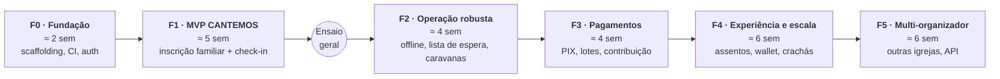

# 03 · Roadmap

Roadmap em fases incrementais. Cada fase termina com algo **em produção e utilizável** — nada fica "pronto só no fim". As durações são estimativas para **1 a 2 desenvolvedores** e devem ser recalibradas ao final da Fase 0.

Os códigos (AUTH-01, CHK-09…) estão definidos no [escopo](02-escopo.md).

> **Data-alvo:** a Fase 1 precisa estar em produção **pelo menos 4 semanas antes da abertura das inscrições do CANTEMOS**, para dar tempo ao ensaio geral do check-in e aos ajustes. Ver [decisões em aberto](05-decisoes-em-aberto.md) (D1).

---

## Fase 0 — Fundação (≈ 2 semanas)

**Objetivo:** projeto rodando de ponta a ponta em produção, ainda sem funcionalidade de negócio.

| Entrega | Detalhe |
|---|---|
| Scaffolding | `frontend/` com Next.js 14 (App Router, TypeScript, Tailwind) e `backend/` com FastAPI (SQLAlchemy 2, Alembic, Pydantic v2) |
| Banco | MySQL 8 local via Docker; primeira migration (usuários, organizações) |
| Qualidade | Lint e formatação (ESLint/Prettier, Ruff), testes (pytest, Vitest), CI no GitHub Actions |
| Ambientes | `staging` e `production` com deploy automático a partir do `main` |
| Design system | Tokens Tailwind (cores, tipografia, espaçamento), componentes base (botão, input, card, modal, toast), layout mobile-first |
| Auth base | AUTH-01, AUTH-02 (cadastro, login, refresh, recuperação de senha) |
| Observabilidade | Logs estruturados, Sentry (front e back), health check |

**Pronto quando:** um usuário consegue se cadastrar e fazer login no ambiente de produção pelo celular.

---

## Fase 1 — MVP CANTEMOS: inscrição e check-in (≈ 5 semanas)

**Objetivo:** realizar o CANTEMOS com ingressos gratuitos, inteiramente pelo EVENTMER.

| Módulo | Itens |
|---|---|
| Acesso | AUTH-03, AUTH-04, AUTH-05 |
| Eventos | EVT-01, EVT-02, EVT-03, EVT-04, EVT-05 |
| Inscrição | TKT-01, TKT-02, **TKT-03 (familiar)**, TKT-04, TKT-05, **TKT-06 (concorrência)** |
| Participante | PART-01, PART-02, PART-03, PART-04 |
| Check-in | CHK-01 a CHK-08, CHK-11 |
| Relatórios | RPT-01, RPT-02 |
| Comunicação | COM-01 |
| LGPD/Segurança | ADM-01, ADM-02, ADM-05 |

**Sugestão de sprints (1 semana cada):**
1. Modelo de dados de evento/sessão/ingresso + CRUD do organizador.
2. Página pública + fluxo de inscrição familiar + controle de lotação.
3. E-mail com QR Code + "Meus ingressos" + cancelamento.
4. Tela de check-in (câmera, busca, resultado, contador ao vivo) + papéis.
5. Dashboard, exportação, lista PDF de contingência, testes de carga e correções.

**Marco — Ensaio geral:** simulação com voluntários reais: 300 ingressos de teste, 4 operadores simultâneos, celulares e tablets variados, Wi-Fi do templo e 4G. Medir tempo por entrada e corrigir antes da abertura real.

**Pronto quando:** os critérios de sucesso do MVP (seção 5 do [escopo](02-escopo.md)) são atingidos no ensaio geral.

---

## Fase 2 — Operação robusta (≈ 4 semanas)

**Objetivo:** reduzir no-show, eliminar dependência de internet na portaria e resolver os casos de grupos — as **lacunas L2, L3, L4, L10, L11** do [benchmark](01-benchmark.md).

| Módulo | Itens |
|---|---|
| Acesso | AUTH-06 (PIN de recepção) |
| Eventos | EVT-06 (duplicar edição) |
| Inscrição | TKT-07 (formulário), TKT-08 (pré-venda), **TKT-09 (lista de espera)**, **TKT-10 (caravanas)**, TKT-11 (origem) |
| Participante | **PART-05 (confirmação de presença)**, PART-06 (transferência) |
| Check-in | **CHK-09 (offline)**, CHK-10 (por porta) |
| Relatórios | RPT-03, RPT-04 |
| Comunicação | COM-02, COM-03, COM-04 |
| LGPD | ADM-03, ADM-04 |

**Pronto quando:** o check-in funciona com o celular em modo avião e sincroniza sem duplicidade; vagas liberadas chegam automaticamente à lista de espera.

---

## Fase 3 — Pagamentos (≈ 4 semanas)

**Objetivo:** permitir eventos pagos e contribuições, com PIX como meio principal.

| Módulo | Itens |
|---|---|
| Inscrição | TKT-12 (lotes), TKT-13 (cupons), TKT-14 (contribuição voluntária) |
| Pagamentos | PAY-01 a PAY-05 |

**Atenção:** escolher o gateway (D4) e validar com a tesouraria da igreja como os valores serão recebidos (conta PJ da igreja, CNPJ).

**Pronto quando:** um pedido pago via PIX gera ingresso automaticamente, e um reembolso volta ao comprador e libera a vaga.

---

## Fase 4 — Experiência e escala (≈ 6 semanas)

**Objetivo:** aproximar a experiência das grandes plataformas e cobrir o credenciamento da equipe interna.

| Módulo | Itens |
|---|---|
| Acesso | AUTH-07 (Google) |
| Eventos | EVT-07 (página personalizável: programação, elenco, FAQ) |
| Inscrição | TKT-15 (mapa de assentos) |
| Participante | PART-07 (Wallet), PART-08 (pesquisa) |
| Check-in | CHK-12 (equipe/bastidores), CHK-13 (crachá), CHK-14 (QR dinâmico) |
| Relatórios | RPT-05 (ano a ano) |
| Comunicação | COM-05 (WhatsApp API) |
| Escala | Fila virtual para abertura de inscrições, cache e CDN para página pública |

---

## Fase 5 — Plataforma multi-organizador (≈ 6 semanas)

**Objetivo:** abrir o EVENTMER para outras igrejas e organizadores.

- ADM-06: cadastro self-service de organizações, isolamento de dados por organização.
- Planos e cobrança da plataforma (se aplicável), split de pagamento por organizador.
- Domínio/subdomínio por organização e white-label.
- API pública e webhooks para integrações.
- Termos de uso e política de privacidade para operador de dados de terceiros (LGPD).

> O modelo de dados já nasce com `organization_id` em todas as entidades (ver [arquitetura](04-arquitetura.md)) para que essa fase não exija reescrita.

---

## Rituais de acompanhamento

- **Planejamento semanal** com a coordenação do CANTEMOS: o que entra na semana, a partir dos códigos do escopo.
- **Demo ao fim de cada sprint** no ambiente de staging, pelo celular.
- **Retrospectiva pós-evento** após cada edição do CANTEMOS, alimentando o backlog da edição seguinte.
- Issues no GitHub com os rótulos `fase:F1`…`fase:F5` e `modulo:CHK`, `modulo:TKT` etc.
