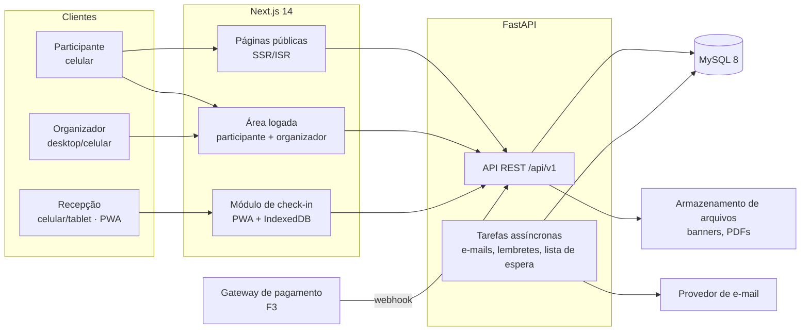
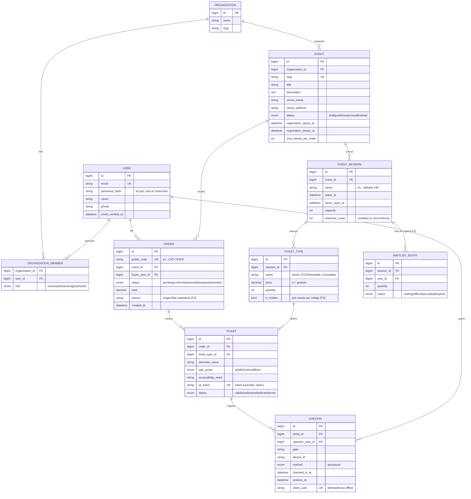

# 04 · Arquitetura

## 1. Stack

| Camada | Tecnologia | Bibliotecas de apoio propostas |
|---|---|---|
| Frontend | React + **Next.js 14** (App Router, TypeScript) + **Tailwind CSS** | TanStack Query (dados), React Hook Form + Zod (formulários), `@zxing/browser` ou `html5-qrcode` (leitura de QR), `next-pwa`/Service Worker, Dexie (IndexedDB, check-in offline) |
| Backend | **Python 3.12 + FastAPI** | SQLAlchemy 2 (ORM), Alembic (migrations), Pydantic v2, PyJWT, `bcrypt` (biblioteca direta; o `passlib` não é mais mantido), `slowapi` (rate limit), `qrcode`, WeasyPrint (PDF), Celery ou ARQ + Redis (tarefas assíncronas — a partir da F2) |
| Banco | **MySQL 8.0** (InnoDB, `utf8mb4`) | — |
| Auth | **JWT + bcrypt** | Access token curto (15 min) + refresh token rotativo em cookie `httpOnly` |
| E-mail | Provedor transacional | Resend, Brevo ou Amazon SES (D5) |
| Pagamentos (F3) | Gateway nacional | Mercado Pago ou Asaas (D4) |

## 2. Visão geral



- O navegador fala só com o domínio do Next.js: `/api/v1/*` é repassado ao FastAPI por *rewrite*. Isso mantém o cookie de refresh no mesmo domínio (`SameSite=Lax`) e dispensa CORS em produção.
- **Um único app Next.js** serve as três experiências (público, participante, organizador/recepção), separadas por rotas e protegidas por papel.
- O **backend é a única fonte da verdade**: regras de lotação, validação de ingresso e check-in ficam no FastAPI, nunca só no frontend.
- O módulo de check-in é uma **PWA** que guarda a lista da sessão em IndexedDB para funcionar offline (F2).

## 3. Organização do código

```
frontend/
├── app/
│   ├── (public)/e/[slug]/          # página do evento e inscrição
│   ├── (participant)/meus-ingressos/
│   ├── (organizer)/painel/          # eventos, sessões, ingressos, relatórios, equipe
│   ├── (checkin)/checkin/[sessionId]/
│   └── (auth)/login, cadastro, recuperar-senha
├── components/ui/                   # design system
├── lib/                             # cliente da API, auth, utilitários
└── public/                          # manifest PWA, ícones

backend/
├── app/
│   ├── main.py
│   ├── core/                        # config, segurança (JWT, bcrypt), deps
│   ├── db/                          # sessão, base, migrations (alembic)
│   ├── modules/
│   │   ├── auth/
│   │   ├── organizations/
│   │   ├── events/                  # eventos e sessões
│   │   ├── tickets/                 # tipos de ingresso, pedidos, ingressos
│   │   ├── checkin/
│   │   ├── reports/
│   │   └── notifications/
│   └── workers/                     # tarefas assíncronas
└── tests/
```

Cada módulo do backend segue `router.py` (endpoints) → `service.py` (regras) → `repository.py` (acesso a dados) → `models.py` / `schemas.py`.

## 4. Modelo de dados inicial

Todas as tabelas de negócio carregam `organization_id` para permitir multi-organizador na F5 sem migração dolorosa. Chaves primárias `BIGINT` internas + `public_id` (UUID hex) exposto nas URLs e na API.



Tabelas complementares (fora do diagrama): `refresh_tokens`, `password_resets`, `consents`, `audit_logs`, `custom_form_fields` / `custom_form_answers` (F2), `group_reservations` (F2), `access_codes` (F2), `coupons` e `payments` (F3).

### Regras críticas

- **Sem overbooking (TKT-06):** a reserva incrementa `event_session.reserved_count` numa transação com `SELECT … FOR UPDATE` (ou `UPDATE … SET reserved_count = reserved_count + :n WHERE id = :id AND reserved_count + :n <= capacity` e checagem de linhas afetadas). Cancelamentos decrementam o contador e disparam a lista de espera.
- **Check-in único (CHK-07):** `UPDATE tickets SET status='used' WHERE id=:id AND status='valid'` com checagem de linhas afetadas (o MySQL não tem índice parcial); a tabela `checkins` guarda o histórico, inclusive os desfeitos. Operação idempotente via `client_uuid` para a sincronização offline. Conflito retorna "já utilizado às HH:MM por <operador>".
- **QR Code:** contém apenas um token opaco (ex.: `public_id` do ingresso + assinatura HMAC). Nada de ID sequencial ou dados pessoais no QR.

## 5. API (rascunho)

Prefixo `/api/v1`. Principais recursos:

| Método | Rota | Quem |
|---|---|---|
| `POST` | `/auth/register`, `/auth/login`, `/auth/refresh`, `/auth/logout`, `/auth/password-reset` | público |
| `GET` | `/public/events/{slug}` | público |
| `POST` | `/public/events/{slug}/orders` | participante |
| `GET` | `/me/orders`, `/me/tickets/{id}` | participante |
| `POST` | `/me/orders/{code}/cancel` | participante |
| `CRUD` | `/org/events`, `/org/events/{id}/sessions`, `/org/sessions/{id}/ticket-types` | admin/manager |
| `GET` | `/org/events/{id}/attendees?export=csv` | admin/manager |
| `GET` | `/org/events/{id}/dashboard` | admin/manager |
| `POST` | `/checkin/sessions/{id}/scan` | checkin |
| `GET` | `/checkin/sessions/{id}/search?q=` | checkin |
| `GET` | `/checkin/sessions/{id}/snapshot` (F2, offline) | checkin |
| `POST` | `/checkin/sessions/{id}/sync` (F2, offline) | checkin |
| `DELETE` | `/checkin/{checkinId}` (desfazer) | checkin/admin |

O contrato fica documentado automaticamente pelo OpenAPI do FastAPI (`/docs`), e o frontend gera os tipos TypeScript a partir dele.

## 6. Segurança e LGPD

- Senhas com **bcrypt** (custo ≥ 12). Nenhuma senha ou token em log.
- **JWT** de acesso com 15 min, assinado com segredo do ambiente; **refresh token** rotativo, armazenado com hash no banco e enviado em cookie `httpOnly`, `Secure`, `SameSite=Lax`.
- **RBAC** por organização verificado no backend em toda rota `/org/*` e `/checkin/*`. O papel `checkin` só enxerga nome, tipo de ingresso, prioridade e status — nunca e-mail, telefone ou CPF.
- **Rate limiting** em login, recuperação de senha, inscrição e scan.
- CORS restrito aos domínios do frontend; cabeçalhos de segurança (CSP, HSTS).
- **LGPD:** coletar o mínimo (CPF opcional), registrar consentimento, permitir exportação/exclusão, anonimizar após o período de retenção, registrar em `audit_logs` toda exportação de dados.

## 7. Responsividade e UX

- **Mobile-first** com breakpoints do Tailwind: base (≥ 360px celular), `md` (≥ 768px tablet), `lg` (≥ 1024px), `xl` (≥ 1280px).
- Alvos de toque ≥ 44×44 px; formulários com teclado adequado (`inputmode="email"`, `tel`, `numeric`).
- **Tela de check-in:** câmera ocupando a maior parte da tela no celular; no tablet em paisagem, câmera de um lado e resultado + contador do outro. Resultado em cor cheia (verde/amarelo/vermelho) legível à distância, com som e vibração.
- Ingresso em "Meus ingressos" com QR grande, brilho alto sugerido e funcionando sem login após aberto pelo link do e-mail (link mágico).
- **PWA:** manifest, ícones, service worker com cache do shell da aplicação.
- Tema claro/escuro; contraste AA.

## 8. Hospedagem (proposta inicial)

| Componente | Opção sugerida | Observação |
|---|---|---|
| Frontend | Vercel | Deploy automático por branch; preview por PR |
| Backend | Railway, Render ou Fly.io (container Docker) | Escala horizontal nos dias críticos |
| MySQL 8 | MySQL gerenciado (Railway, Aiven, AWS RDS ou DigitalOcean) | Backups automáticos diários |
| Arquivos | Cloudflare R2 ou AWS S3 | Banners e PDFs |
| E-mail | Resend / Brevo / SES | Configurar SPF, DKIM e DMARC no domínio |
| Monitoramento | Sentry + uptime monitor (Better Stack / UptimeRobot) | Alertas no WhatsApp/Telegram da equipe |

Domínio sugerido: `eventmer.com.br` (verificar disponibilidade — D2).
